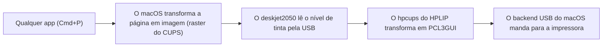

# &nbsp;&nbsp;HP Deskjet 2050&nbsp;&nbsp;

**[Read in English](#en-hp-deskjet-2050)**

A HP não dá mais suporte a essa impressora no Mac. O driver oficial antigo é só para Intel e não funciona nas versões recentes do macOS, nem com o Rosetta.

Este projeto pega o filtro `hpcups` do [HPLIP](https://developers.hp.com/hp-linux-imaging-and-printing), o driver open source da própria HP para Linux, compila nativo para Apple Silicon e instala como um driver CUPS comum. Depois de instalado, a impressora aparece na janela de impressão normal (Cmd+P) de qualquer app, incluindo o Chrome e o Pré-Visualização.

## Situação

- **Impressão pela USB:** funcionando, testada no macOS 27.
- **Preto e branco:** testado no papel, usando só o cartucho preto.
- **Colorido:** gera uma saída válida nos testes sem impressora, mas ainda não foi impresso no papel.
- **Papel e qualidade:** A4 e Carta, além dos modos rascunho, normal, melhor e foto do HPLIP.
- **Nível de tinta:** aparece no app DeskJet 2050, em porcentagem por cartucho, e nos Ajustes do Mac. É lido direto da impressora pela USB.
- **App:** mostra o nível de tinta e instala ou desinstala o driver, em 13 idiomas: português, inglês, espanhol, francês, italiano, alemão, holandês, polonês, russo, turco, árabe, indonésio e chinês simplificado.
- **Scanner:** ainda não é suportado.

## Requisitos

- Um Mac com Apple Silicon. O app precisa do macOS 14 ou mais novo.
- O [Homebrew](https://brew.sh). Para instalar, cole no Terminal o comando do site dele. Isso é feito uma vez só.
- As ferramentas de linha de comando do Xcode. Se faltarem, o instalador abre a janela da Apple para instalar.
- A impressora ligada na USB. Se o macOS perguntar se você permite a conexão do acessório, clique em **Permitir**. Se clicou em **Não Permitir**, tire o cabo e conecte de novo.

## Instalação

1. Baixe o **`DeskJet-2050-app`** da [versão mais recente](https://github.com/jonathaxs/deskjet-2050-macos/releases/latest) (não os arquivos "Source code") e abra o zip.
2. Arraste o **DeskJet 2050** para a pasta **Aplicativos** e abra. Na primeira vez o macOS bloqueia o app; veja como liberar logo abaixo.
3. No app, clique em **Instalar…**. O app já mostra o nível de tinta e o que falta no Mac antes de instalar.

Uma janela do Terminal abre e faz tudo: confere os requisitos, instala o jpeg-turbo pelo Homebrew se precisar, baixa o HPLIP, compila o driver e instala. Quando pedir, digite a senha do seu Mac e aperte Enter. Nada aparece enquanto você digita, é normal. Quando aparecer "Installed", aperte Enter para fechar. A senha é digitada só no Terminal: o app nunca a vê.

No alto da janela do app, o botão **Driver** reinstala ou desinstala o driver, e o botão **Ajustes** (ou Cmd+vírgula) escolhe a aparência clara, escura ou igual à do Mac e liga o ícone na barra de menus.

### Se o macOS bloquear o app

Quando o app vem de um download pelo navegador, pelo AirDrop ou por mensagem, o macOS bloqueia na primeira vez, porque ele não é assinado pela Apple. Para liberar uma vez:

1. Abra o DeskJet 2050 e clique em **OK** no aviso.
2. Abra **Ajustes do Sistema > Privacidade e Segurança**.
3. Role até a mensagem sobre o DeskJet 2050 e clique em **Abrir Mesmo Assim**.
4. Confirme com a sua senha ou o Touch ID e clique em **Abrir**.

Depois disso ele abre normalmente. O app libera sozinho os scripts do driver que ele leva dentro, então não precisa repetir isso para eles.

### Sem o app

Baixe o zip **`deskjet-2050-driver`** da mesma [versão](https://github.com/jonathaxs/deskjet-2050-macos/releases/latest), abra a pasta `deskjet-2050-driver` e dê dois cliques no **`Install.command`**. Se você clonou o repositório, os mesmos arquivos estão na pasta `driver`. O Terminal faz os mesmos passos de cima. Se o macOS bloquear o `Install.command`, libere do mesmo jeito que o app, procurando a mensagem sobre o `Install.command`.

### O que o instalador muda

- Copia o filtro e o leitor de nível de tinta para `/Library/Printers/DeskJet2050/Filter/`.
- Instala a descrição da impressora (PPD) em `/Library/Printers/PPDs/Contents/Resources/`.
- Cria a fila `Deskjet_2050`, sem compartilhar na rede, com A4 ou Carta como papel padrão de acordo com a região do Mac.

Nada mais no sistema é alterado, e o SIP continua ligado.

### Pelo Terminal

Os mesmos passos, na mão:

```bash
git clone https://github.com/jonathaxs/deskjet-2050-macos.git
cd deskjet-2050-macos/driver/files
brew install jpeg-turbo
./scripts/fetch-hplip.sh
make
sudo ./scripts/install.sh
```

Para testar o filtro sem a impressora, depois do `make`, rode `./scripts/test-filter.sh`.

Para compilar o app, rode `app/scripts/build-app.sh` na raiz do repositório. Ele precisa só das ferramentas de linha de comando do Xcode e gera o `DeskJet 2050.app` em `app/build`.

## Nível de tinta

Abra o app **DeskJet 2050**: ele mostra a porcentagem de cada cartucho, se é original HP e a marca em que a impressora começa a avisar que a tinta está baixa. O app lê a impressora pela USB e funciona mesmo sem o driver instalado. Nos ajustes do app dá para ligar o ícone na barra de menus, com os níveis ao lado do relógio.

Sem o app, abra **Ajustes do Sistema > Impressoras e Scanners**, escolha a HP Deskjet 2050 e clique em **Opções e Suprimentos**. O nível é atualizado a cada impressão. Para ver na hora, sem imprimir, rode no Terminal:

```bash
/Library/Printers/DeskJet2050/Filter/deskjet2050
```

O nível é a estimativa da própria impressora. Um cartucho seco pode continuar mostrando tinta.

## Desinstalação

No app, clique em **Driver** e depois em **Desinstalar…**. Sem o app, dê dois cliques no **`Uninstall.command`** da pasta `driver`, ou rode `sudo ./scripts/uninstall.sh` de dentro de `driver/files`. Isso remove a fila, o filtro e o PPD.

## Problemas comuns

**Texto cinza ou preto sai fraco, ou nem sai.** Escolha Preto e branco (ou Tons de cinza) na janela de impressão. No modo colorido, só o preto puro usa o cartucho preto. Cinzas escuros e cores usam o cartucho colorido, e se ele estiver vazio, parte da página pode sumir.

**A impressora não foi encontrada.** O app mostra um passo a passo. Confira o cabo, ligue a impressora e veja em **Ajustes do Sistema > Privacidade e Segurança** se **Permitir que acessórios se conectem** não está bloqueando. Pelo Terminal, rode `lpinfo -v`. Deve aparecer um endereço começando com `usb://HP/Deskjet%202050`. Depois rode o instalador de novo. Se precisar, dá para passar o endereço na mão: `sudo PRINTER_URI="usb://..." ./scripts/install.sh`

**Papel padrão errado.** Rode `sudo PAGE_SIZE=A4 ./scripts/install.sh` (ou `Letter` para Carta) de dentro de `driver/files`.

**Outro problema.** O log do CUPS fica em `/var/log/cups/error_log`, e o log do build em `driver/files/build/make.log`. Abrir uma issue contando o que aconteceu, com o final desses logs, ajuda bastante.

## Como funciona



- Só o filtro `hpcups` é compilado, direto dos arquivos do HPLIP, sem o configure do HPLIP (que exige libusb, SANE e outras coisas que o filtro não usa).
- A libjpeg é linkada estática, então o filtro depende só de bibliotecas do sistema.
- O código do HPLIP não fica guardado neste repositório. Ele é baixado na hora do build e conferido contra um hash fixo.
- O filtro é compilado no seu próprio Mac, então não existe um binário baixado para o Gatekeeper bloquear.
- O nível de tinta vem do mesmo pedido que o HPLIP faz no Linux: um HTTP GET de `/DevMgmt/ConsumableConfigDyn.xml` na interface USB de status da impressora. O `deskjet2050` faz isso com o IOKit e repassa os níveis ao CUPS.
- O app é feito em SwiftUI e usa o mesmo código em C do `deskjet2050` para ler o nível, sem precisar de senha. Para instalar, ele copia a pasta `driver` que leva dentro para `~/Library/Application Support/DeskJet2050` e abre o `Install.command` no Terminal.

## Licença e créditos

Baseado no [HPLIP](https://developers.hp.com/hp-linux-imaging-and-printing), da HP Development Company, L.P. A maior parte do código do `hpcups` está sob a licença BSD da HP, e uma parte dele (`ErnieFilter`, usada por esta impressora) é GPL-2.0-or-later. Por isso, este projeto é distribuído sob a **GPL-2.0-or-later**. Veja o [LICENSE](../LICENSE).

HP e Deskjet são marcas da HP Inc. Este projeto não tem ligação com a HP nem é endossado por ela.

## Autor

Desenvolvido por **Jonathas Motta** ([@jonathaxs](https://github.com/jonathaxs)), com assistência do Claude.

---

# &nbsp;&nbsp;(EN) HP Deskjet 2050&nbsp;&nbsp;

**[Leia em português](#hp-deskjet-2050)**

HP no longer supports this printer on the Mac. The old official driver is Intel only and does not work on recent versions of macOS, not even with Rosetta.

This project takes the `hpcups` filter from [HPLIP](https://developers.hp.com/hp-linux-imaging-and-printing), HP's own open source driver for Linux, builds it natively for Apple Silicon and installs it as a regular CUPS driver. Once installed, the printer shows up in the normal print dialog (Cmd+P) of any app, including Chrome and Preview.

## Status

- **Printing over USB:** working, tested on macOS 27.
- **Black and white:** tested on paper, using only the black cartridge.
- **Color:** produces valid output in the offline tests, but has not been printed on paper yet.
- **Paper and quality:** A4 and Letter, plus the draft, normal, best and photo modes from HPLIP.
- **Ink levels:** shown in the DeskJet 2050 app, as a percentage per cartridge, and in System Settings. They are read straight from the printer over USB.
- **App:** shows the ink levels and installs or uninstalls the driver, in 13 languages: English, Portuguese, Spanish, French, Italian, German, Dutch, Polish, Russian, Turkish, Arabic, Indonesian and Simplified Chinese.
- **Scanner:** not supported yet.

## Requirements

- A Mac with Apple Silicon. The app needs macOS 14 or later.
- [Homebrew](https://brew.sh). To install it, paste the command from its site into Terminal. You only do this once.
- Xcode Command Line Tools. If they are missing, the installer opens Apple's window to install them.
- The printer plugged in over USB and turned on. If macOS asks whether to allow the accessory to connect, click **Allow**. If you clicked **Don't Allow**, unplug the cable and plug it in again.

## Install

1. Download **`DeskJet-2050-app`** from the [latest release](https://github.com/jonathaxs/deskjet-2050-macos/releases/latest) (not the "Source code" files) and open the zip.
2. Drag **DeskJet 2050** to the **Applications** folder and open it. The first time, macOS blocks the app; see how to allow it right below.
3. In the app, click **Install…**. The app already shows the ink levels and anything the Mac is missing before installing.

A Terminal window opens and does everything: it checks the requirements, installs jpeg-turbo with Homebrew if needed, downloads HPLIP, builds the driver and installs it. When it asks, type your Mac password and press Enter. Nothing shows up while you type, that is normal. When you see "Installed", press Enter to close. The password is typed only in Terminal: the app never sees it.

At the top of the app window, the **Driver** button reinstalls or uninstalls the driver, and the **Settings** button (or Cmd+comma) picks a light, dark or Mac-matching appearance and turns on the menu bar icon.

### If macOS blocks the app

When the app comes from a browser download, AirDrop or a message, macOS blocks it the first time, because it is not signed by Apple. To allow it once:

1. Open DeskJet 2050 and click **Done** in the warning.
2. Open **System Settings > Privacy & Security**.
3. Scroll down to the message about DeskJet 2050 and click **Open Anyway**.
4. Confirm with your password or Touch ID, then click **Open**.

After that it opens normally. The app clears the block on the driver scripts it carries, so you do not need to do this again for them.

### Without the app

Download the **`deskjet-2050-driver`** zip from the same [release](https://github.com/jonathaxs/deskjet-2050-macos/releases/latest), open the `deskjet-2050-driver` folder and double-click **`Install.command`**. If you cloned the repository, the same files are in the `driver` folder. Terminal runs the same steps as above. If macOS blocks `Install.command`, allow it the same way as the app, looking for the message about `Install.command`.

### What the installer changes

- Copies the filter and the ink level reader to `/Library/Printers/DeskJet2050/Filter/`.
- Installs the printer description (PPD) in `/Library/Printers/PPDs/Contents/Resources/`.
- Creates the `Deskjet_2050` queue, not shared on the network, with A4 or Letter as the default paper based on your Mac's region.

Nothing else on the system is changed, and SIP stays on.

### From the Terminal

The same steps, by hand:

```bash
git clone https://github.com/jonathaxs/deskjet-2050-macos.git
cd deskjet-2050-macos/driver/files
brew install jpeg-turbo
./scripts/fetch-hplip.sh
make
sudo ./scripts/install.sh
```

To test the filter without a printer, after `make`, run `./scripts/test-filter.sh`.

To build the app, run `app/scripts/build-app.sh` from the repository root. It only needs the Xcode Command Line Tools and creates `DeskJet 2050.app` in `app/build`.

## Ink levels

Open the **DeskJet 2050** app: it shows the percentage of each cartridge, whether it is genuine HP, and the mark where the printer starts warning that ink is low. The app reads the printer over USB and works even without the driver installed. In the app's settings you can turn on the menu bar icon, with the levels next to the clock.

Without the app, open **System Settings > Printers & Scanners**, pick the HP Deskjet 2050 and click **Options & Supplies**. The levels are updated on every print. To see them right away, without printing, run in Terminal:

```bash
/Library/Printers/DeskJet2050/Filter/deskjet2050
```

The level is the printer's own estimate. A dried-out cartridge can still show ink left.

## Uninstall

In the app, click **Driver**, then **Uninstall…**. Without the app, double-click **`Uninstall.command`** in the `driver` folder, or run `sudo ./scripts/uninstall.sh` from `driver/files`. This removes the queue, the filter and the PPD.

## Troubleshooting

**Gray or black text comes out faint, or does not print at all.** Pick Black & White (or Grayscale) in the print dialog. In color mode, only pure black uses the black cartridge. Dark grays and colors use the color cartridge, so if it is empty, part of the page can disappear.

**The printer was not found.** The app shows the steps. Check the cable, turn the printer on and check that **Allow accessories to connect** in **System Settings > Privacy & Security** is not blocking it. From the Terminal, run `lpinfo -v`. It should list an address starting with `usb://HP/Deskjet%202050`. Then run the installer again. If needed, you can pass the address yourself: `sudo PRINTER_URI="usb://..." ./scripts/install.sh`

**Wrong default paper size.** Run `sudo PAGE_SIZE=Letter ./scripts/install.sh` (or `A4`) from `driver/files`.

**Something else.** The CUPS log is in `/var/log/cups/error_log`, and the build log is in `driver/files/build/make.log`. Opening an issue with what happened and the end of those logs helps a lot.

## How it works


- Only the `hpcups` filter is compiled, straight from the HPLIP files, without the HPLIP configure script (which needs libusb, SANE and other things the filter does not use).
- libjpeg is linked statically, so the filter only depends on system libraries.
- The HPLIP source is not stored in this repository. It is downloaded at build time and checked against a fixed hash.
- The filter is built on your own Mac, so there is no downloaded binary for Gatekeeper to block.
- The ink levels come from the same request HPLIP makes on Linux: an HTTP GET of `/DevMgmt/ConsumableConfigDyn.xml` on the printer's USB status interface. `deskjet2050` does it with IOKit and hands the levels to CUPS.
- The app is written in SwiftUI and uses the same C code as `deskjet2050` to read the levels, with no password. To install, it copies the `driver` folder it carries to `~/Library/Application Support/DeskJet2050` and opens `Install.command` in Terminal.

## Repository structure

```text
deskjet-2050-macos/
├── .github/                     This README and its icons
├── LICENSE                      GPL-2.0
├── app/                         The DeskJet 2050 app (Swift package)
│   ├── Sources/                 SwiftUI views and the C ink level reader
│   ├── Resources/               Translations and the icon
│   └── scripts/
│       ├── build-app.sh         Builds "DeskJet 2050.app" in app/build
│       ├── make-icon.swift      Draws the pixel art icon
│       └── release.sh           Builds the release zips in dist/
└── driver/
    ├── files/
    │   ├── Makefile             Builds hpcups for arm64
    │   ├── src/levels.c         Runs hpcups and passes the ink levels to CUPS
    │   ├── src/ledm.c           Reads the ink levels over USB (shared with the app)
    │   └── scripts/
    │       ├── fetch-hplip.sh   Downloads and verifies the HPLIP source
    │       ├── test-filter.sh   Tests the filter without a printer
    │       ├── install.sh       Installs the driver and creates the queue
    │       └── uninstall.sh     Removes everything install.sh added
    ├── Guide.txt                Short instructions that travel with the folder
    ├── Install.command          Double-click to install
    └── Uninstall.command        Double-click to uninstall
```

## License and credits

Based on [HPLIP](https://developers.hp.com/hp-linux-imaging-and-printing) by HP Development Company, L.P. Most of the `hpcups` code is under HP's BSD license, and one part of it (`ErnieFilter`, used by this printer) is GPL-2.0-or-later. Because of that, this project is distributed under the **GPL-2.0-or-later**. See [LICENSE](../LICENSE).

HP and Deskjet are trademarks of HP Inc. This project is not affiliated with or endorsed by HP.

## Author

Developed by **Jonathas Motta** ([@jonathaxs](https://github.com/jonathaxs)), with assistance from Claude.
