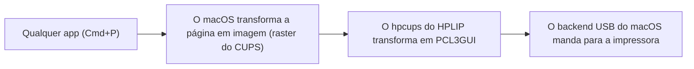

# HP Deskjet 2050 para macOS

**[Read in English](#en-hp-deskjet-2050-for-macos)**

A HP não dá mais suporte a essa impressora no Mac. O driver oficial antigo é só para Intel e não funciona nas versões recentes do macOS, nem com o Rosetta.

Este projeto pega o filtro `hpcups` do [HPLIP](https://developers.hp.com/hp-linux-imaging-and-printing), o driver open source da própria HP para Linux, compila nativo para Apple Silicon e instala como um driver CUPS comum. Depois de instalado, a impressora aparece na janela de impressão normal (Cmd+P) de qualquer app, incluindo o Chrome e o Pré-Visualização.

## Situação

- **Impressão pela USB:** funcionando, testada no macOS 27.
- **Preto e branco:** testado no papel, usando só o cartucho preto.
- **Colorido:** gera uma saída válida nos testes sem impressora, mas ainda não foi impresso no papel.
- **Papel e qualidade:** A4 e Carta, além dos modos rascunho, normal, melhor e foto do HPLIP.
- **Scanner:** ainda não é suportado.

## Requisitos

- Um Mac com Apple Silicon.
- O [Homebrew](https://brew.sh). Para instalar, cole no Terminal o comando do site dele. Isso é feito uma vez só.
- As ferramentas de linha de comando do Xcode. Se faltarem, o instalador abre a janela da Apple para instalar.
- A impressora ligada na USB. Se o macOS perguntar se você permite a conexão do acessório, clique em **Permitir**. Se clicou em **Não Permitir**, tire o cabo e conecte de novo.

## Instalação

Baixe o zip **`deskjet-2050-driver`** da [versão mais recente](https://github.com/jonathaxs/deskjet-2050-macos/releases/latest) (não os arquivos "Source code") e abra. Depois abra a pasta `deskjet-2050-driver` e dê dois cliques no **`Install.command`**. Se você clonou o repositório, os mesmos arquivos estão na pasta `driver`.

Uma janela do Terminal abre e faz tudo: confere os requisitos, instala o jpeg-turbo pelo Homebrew se precisar, baixa o HPLIP, compila o driver e instala. Quando pedir, digite a senha do seu Mac e aperte Enter. Nada aparece enquanto você digita, é normal. Quando aparecer "Installed", aperte Enter para fechar.

### Se o macOS bloquear o Install.command

Quando os arquivos vêm de um download pelo navegador, pelo AirDrop ou por mensagem, o macOS bloqueia o `Install.command` na primeira vez, porque ele não é assinado pela Apple. Clonando com o `git` isso não acontece. Para liberar uma vez:

1. Dê dois cliques no `Install.command` e clique em **OK** no aviso.
2. Abra **Ajustes do Sistema > Privacidade e Segurança**.
3. Role até a mensagem sobre o `Install.command` e clique em **Abrir Mesmo Assim**.
4. Confirme com a sua senha ou o Touch ID e clique em **Abrir**.

### O que o instalador muda

- Copia o filtro para `/Library/Printers/DeskJet2050/Filter/`.
- Instala a descrição da impressora (PPD) em `/Library/Printers/PPDs/Contents/Resources/`.
- Cria a fila `Deskjet_2050`, sem compartilhar na rede, com A4 ou Carta como papel padrão de acordo com a região do Mac.

Nada mais no sistema é alterado, e o SIP continua ligado.

### Pelo Terminal

Os mesmos passos, na mão:

```bash
git clone https://github.com/jonathaxs/deskjet-2050-macos.git
cd deskjet-2050-macos/driver/files
brew install jpeg-turbo
./scripts/fetch-hplip.sh
make
sudo ./scripts/install.sh
```

Para testar o filtro sem a impressora, depois do `make`, rode `./scripts/test-filter.sh`.

## Desinstalação

Dê dois cliques no **`Uninstall.command`** da pasta `driver`, ou rode `sudo ./scripts/uninstall.sh` de dentro de `driver/files`. Isso remove a fila, o filtro e o PPD.

## Problemas comuns

**Texto cinza ou preto sai fraco, ou nem sai.** Escolha Preto e branco (ou Tons de cinza) na janela de impressão. No modo colorido, só o preto puro usa o cartucho preto. Cinzas escuros e cores usam o cartucho colorido, e se ele estiver vazio, parte da página pode sumir.

**A impressora não foi encontrada.** Confira o cabo, ligue a impressora e rode `lpinfo -v`. Deve aparecer um endereço começando com `usb://HP/Deskjet%202050`. Depois rode o instalador de novo. Se precisar, dá para passar o endereço na mão: `sudo PRINTER_URI="usb://..." ./scripts/install.sh`

**Papel padrão errado.** Rode `sudo PAGE_SIZE=A4 ./scripts/install.sh` (ou `Letter` para Carta) de dentro de `driver/files`.

**Outro problema.** O log do CUPS fica em `/var/log/cups/error_log`, e o log do build em `driver/files/build/make.log`. Abrir uma issue contando o que aconteceu, com o final desses logs, ajuda bastante.

## Como funciona



- Só o filtro `hpcups` é compilado, direto dos arquivos do HPLIP, sem o configure do HPLIP (que exige libusb, SANE e outras coisas que o filtro não usa).
- A libjpeg é linkada estática, então o filtro depende só de bibliotecas do sistema.
- O código do HPLIP não fica guardado neste repositório. Ele é baixado na hora do build e conferido contra um hash fixo.
- O filtro é compilado no seu próprio Mac, então não existe um binário baixado para o Gatekeeper bloquear.

## Licença e créditos

Baseado no [HPLIP](https://developers.hp.com/hp-linux-imaging-and-printing), da HP Development Company, L.P. A maior parte do código do `hpcups` está sob a licença BSD da HP, e uma parte dele (`ErnieFilter`, usada por esta impressora) é GPL-2.0-or-later. Por isso, este projeto é distribuído sob a **GPL-2.0-or-later**. Veja o [LICENSE](../LICENSE).

HP e Deskjet são marcas da HP Inc. Este projeto não tem ligação com a HP nem é endossado por ela.

## Autor

Desenvolvido por [@jonathaxs](https://github.com/jonathaxs) com assistência do Claude.

---

# (EN) HP Deskjet 2050 for macOS

**[Leia em português](#hp-deskjet-2050-para-macos)**

HP no longer supports this printer on the Mac. The old official driver is Intel only and does not work on recent versions of macOS, not even with Rosetta.

This project takes the `hpcups` filter from [HPLIP](https://developers.hp.com/hp-linux-imaging-and-printing), HP's own open source driver for Linux, builds it natively for Apple Silicon and installs it as a regular CUPS driver. Once installed, the printer shows up in the normal print dialog (Cmd+P) of any app, including Chrome and Preview.

## Status

- **Printing over USB:** working, tested on macOS 27.
- **Black and white:** tested on paper, using only the black cartridge.
- **Color:** produces valid output in the offline tests, but has not been printed on paper yet.
- **Paper and quality:** A4 and Letter, plus the draft, normal, best and photo modes from HPLIP.
- **Scanner:** not supported yet.

## Requirements

- A Mac with Apple Silicon.
- [Homebrew](https://brew.sh). To install it, paste the command from its site into Terminal. You only do this once.
- Xcode Command Line Tools. If they are missing, the installer opens Apple's window to install them.
- The printer plugged in over USB and turned on. If macOS asks whether to allow the accessory to connect, click **Allow**. If you clicked **Don't Allow**, unplug the cable and plug it in again.

## Install

Download the **`deskjet-2050-driver`** zip from the [latest release](https://github.com/jonathaxs/deskjet-2050-macos/releases/latest) (not the "Source code" files) and open it. Then open the `deskjet-2050-driver` folder and double-click **`Install.command`**. If you cloned the repository, the same files are in the `driver` folder.

A Terminal window opens and does everything: it checks the requirements, installs jpeg-turbo with Homebrew if needed, downloads HPLIP, builds the driver and installs it. When it asks, type your Mac password and press Enter. Nothing shows up while you type, that is normal. When you see "Installed", press Enter to close.

### If macOS blocks Install.command

When the files come from a browser download, AirDrop or a message, macOS blocks `Install.command` the first time, because it is not signed by Apple. Cloning with `git` does not trigger this. To allow it once:

1. Double-click `Install.command` and click **Done** in the warning.
2. Open **System Settings > Privacy & Security**.
3. Scroll down to the message about `Install.command` and click **Open Anyway**.
4. Confirm with your password or Touch ID, then click **Open**.

### What the installer changes

- Copies the filter to `/Library/Printers/DeskJet2050/Filter/`.
- Installs the printer description (PPD) in `/Library/Printers/PPDs/Contents/Resources/`.
- Creates the `Deskjet_2050` queue, not shared on the network, with A4 or Letter as the default paper based on your Mac's region.

Nothing else on the system is changed, and SIP stays on.

### From the Terminal

The same steps, by hand:

```bash
git clone https://github.com/jonathaxs/deskjet-2050-macos.git
cd deskjet-2050-macos/driver/files
brew install jpeg-turbo
./scripts/fetch-hplip.sh
make
sudo ./scripts/install.sh
```

To test the filter without a printer, after `make`, run `./scripts/test-filter.sh`.

## Uninstall

Double-click **`Uninstall.command`** in the `driver` folder, or run `sudo ./scripts/uninstall.sh` from `driver/files`. This removes the queue, the filter and the PPD.

## Troubleshooting

**Gray or black text comes out faint, or does not print at all.** Pick Black & White (or Grayscale) in the print dialog. In color mode, only pure black uses the black cartridge. Dark grays and colors use the color cartridge, so if it is empty, part of the page can disappear.

**The printer was not found.** Check the cable, turn the printer on and run `lpinfo -v`. It should list an address starting with `usb://HP/Deskjet%202050`. Then run the installer again. If needed, you can pass the address yourself: `sudo PRINTER_URI="usb://..." ./scripts/install.sh`

**Wrong default paper size.** Run `sudo PAGE_SIZE=Letter ./scripts/install.sh` (or `A4`) from `driver/files`.

**Something else.** The CUPS log is in `/var/log/cups/error_log`, and the build log is in `driver/files/build/make.log`. Opening an issue with what happened and the end of those logs helps a lot.

## How it works


- Only the `hpcups` filter is compiled, straight from the HPLIP files, without the HPLIP configure script (which needs libusb, SANE and other things the filter does not use).
- libjpeg is linked statically, so the filter only depends on system libraries.
- The HPLIP source is not stored in this repository. It is downloaded at build time and checked against a fixed hash.
- The filter is built on your own Mac, so there is no downloaded binary for Gatekeeper to block.

## Repository structure

```text
deskjet-2050-macos/
├── .github/                     This README
├── LICENSE                      GPL-2.0
└── driver/
    ├── files/
    │   ├── Makefile             Builds hpcups for arm64
    │   └── scripts/
    │       ├── fetch-hplip.sh   Downloads and verifies the HPLIP source
    │       ├── test-filter.sh   Tests the filter without a printer
    │       ├── install.sh       Installs the driver and creates the queue
    │       └── uninstall.sh     Removes everything install.sh added
    ├── Guide.txt                Short instructions that travel with the folder
    ├── Install.command          Double-click to install
    └── Uninstall.command        Double-click to uninstall
```

## License and credits

Based on [HPLIP](https://developers.hp.com/hp-linux-imaging-and-printing) by HP Development Company, L.P. Most of the `hpcups` code is under HP's BSD license, and one part of it (`ErnieFilter`, used by this printer) is GPL-2.0-or-later. Because of that, this project is distributed under the **GPL-2.0-or-later**. See [LICENSE](../LICENSE).

HP and Deskjet are trademarks of HP Inc. This project is not affiliated with or endorsed by HP.

## Author

Developed by [@jonathaxs](https://github.com/jonathaxs) with assistance from Claude.
