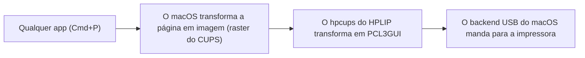

# HP Deskjet 2050 for macOS

_A native Apple Silicon driver for the HP Deskjet 2050 All-in-One (J510) on current macOS._

**[Leia em português](#hp-deskjet-2050-para-macos)**

HP no longer supports this printer on the Mac. The old official driver is Intel only and does not work on recent versions of macOS, not even with Rosetta.

This project takes the `hpcups` filter from [HPLIP](https://developers.hp.com/hp-linux-imaging-and-printing), HP's own open source driver for Linux, builds it natively for Apple Silicon and installs it as a regular CUPS driver. Once installed, the printer shows up in the normal print dialog (Cmd+P) of any app, including Chrome and Preview.

## Status

- **Printing over USB:** working, tested on macOS 27.
- **Black and white:** tested on paper, using only the black cartridge.
- **Color:** produces valid output in the offline tests, but has not been printed on paper yet.
- **Paper and quality:** A4 and Letter, plus the draft, normal, best and photo modes from HPLIP.
- **Scanner:** not supported yet.

## Requirements

- A Mac with Apple Silicon.
- Xcode Command Line Tools: `xcode-select --install`
- [Homebrew](https://brew.sh) with jpeg-turbo: `brew install jpeg-turbo`
- The printer plugged in over USB and turned on.

## Install

```bash
git clone https://github.com/jonathaxs/deskjet-2050-macos.git
cd deskjet-2050-macos/driver
./scripts/fetch-hplip.sh
make
sudo ./scripts/install.sh
```

What each step does:

1. `fetch-hplip.sh` downloads the HPLIP source from SourceForge and checks its SHA-256.
2. `make` builds the filter in `driver/build/hpcups`.
3. `install.sh` asks for your Mac password (because of `sudo`) and then:
   - copies the filter to `/Library/Printers/DeskJet2050/Filter/`
   - installs the printer description (PPD) in `/Library/Printers/PPDs/Contents/Resources/`
   - creates the `Deskjet_2050` queue, not shared on the network, with A4 or Letter as the default paper based on your Mac's region

Nothing else on the system is changed, and SIP stays on.

To print a test page from the Terminal:

```bash
lp -d Deskjet_2050 file.pdf
```

To test the filter without a printer, after `make`:

```bash
./scripts/test-filter.sh
```

## Uninstall

```bash
cd deskjet-2050-macos/driver
sudo ./scripts/uninstall.sh
```

This removes the queue, the filter and the PPD.

## Troubleshooting

**Gray or black text comes out faint, or does not print at all.** Pick Black & White (or Grayscale) in the print dialog. In color mode, only pure black uses the black cartridge. Dark grays and colors use the color cartridge, so if it is empty, part of the page can disappear.

**The printer was not found.** Check the cable, turn the printer on and run `lpinfo -v`. It should list an address starting with `usb://HP/Deskjet%202050`. Then run `install.sh` again. If needed, you can pass the address yourself: `sudo PRINTER_URI="usb://..." ./scripts/install.sh`

**Wrong default paper size.** Run `sudo PAGE_SIZE=Letter ./scripts/install.sh` (or `A4`).

**Something else.** The CUPS log is in `/var/log/cups/error_log`. Opening an issue with what happened and the end of that log helps a lot.

## How it works


- Only the `hpcups` filter is compiled, straight from the HPLIP files, without the HPLIP configure script (which needs libusb, SANE and other things the filter does not use).
- libjpeg is linked statically, so the filter only depends on system libraries.
- The HPLIP source is not stored in this repository. It is downloaded at build time and checked against a fixed hash.
- The filter is built on your own Mac, so there is no unsigned binary for Gatekeeper to block.

## Repository structure

```text
deskjet-2050-macos/
├── .github/                 This README
├── LICENSE                  GPL-2.0
└── driver/
    ├── Makefile             Builds hpcups for arm64
    └── scripts/
        ├── fetch-hplip.sh   Downloads and verifies the HPLIP source
        ├── test-filter.sh   Tests the filter without a printer
        ├── install.sh       Installs the driver and creates the queue
        └── uninstall.sh     Removes everything install.sh added
```

## License and credits

Based on [HPLIP](https://developers.hp.com/hp-linux-imaging-and-printing) by HP Development Company, L.P. Most of the `hpcups` code is under HP's BSD license, and one part of it (`ErnieFilter`, used by this printer) is GPL-2.0-or-later. Because of that, this project is distributed under the **GPL-2.0-or-later**. See [LICENSE](../LICENSE).

HP and Deskjet are trademarks of HP Inc. This project is not affiliated with or endorsed by HP.

## Author

Developed by **Jonathas Motta** ([@jonathaxs](https://github.com/jonathaxs)) with help from Claude.

---

# HP Deskjet 2050 para macOS

_Um driver nativo para Apple Silicon da HP Deskjet 2050 All-in-One (J510) no macOS atual._

**[Read in English](#hp-deskjet-2050-for-macos)**

A HP não dá mais suporte a essa impressora no Mac. O driver oficial antigo é só para Intel e não funciona nas versões recentes do macOS, nem com o Rosetta.

Este projeto pega o filtro `hpcups` do [HPLIP](https://developers.hp.com/hp-linux-imaging-and-printing), o driver open source da própria HP para Linux, compila nativo para Apple Silicon e instala como um driver CUPS comum. Depois de instalado, a impressora aparece na janela de impressão normal (Cmd+P) de qualquer app, incluindo o Chrome e o Pré-Visualização.

## Situação

- **Impressão pela USB:** funcionando, testada no macOS 27.
- **Preto e branco:** testado no papel, usando só o cartucho preto.
- **Colorido:** gera uma saída válida nos testes sem impressora, mas ainda não foi impresso no papel.
- **Papel e qualidade:** A4 e Carta, além dos modos rascunho, normal, melhor e foto do HPLIP.
- **Scanner:** ainda não é suportado.

## Requisitos

- Um Mac com Apple Silicon.
- Ferramentas de linha de comando do Xcode: `xcode-select --install`
- [Homebrew](https://brew.sh) com o jpeg-turbo: `brew install jpeg-turbo`
- A impressora ligada na USB.

## Instalação

```bash
git clone https://github.com/jonathaxs/deskjet-2050-macos.git
cd deskjet-2050-macos/driver
./scripts/fetch-hplip.sh
make
sudo ./scripts/install.sh
```

O que cada passo faz:

1. `fetch-hplip.sh` baixa o código do HPLIP da SourceForge e confere o SHA-256.
2. `make` compila o filtro em `driver/build/hpcups`.
3. `install.sh` pede a senha do seu Mac (por causa do `sudo`) e então:
   - copia o filtro para `/Library/Printers/DeskJet2050/Filter/`
   - instala a descrição da impressora (PPD) em `/Library/Printers/PPDs/Contents/Resources/`
   - cria a fila `Deskjet_2050`, sem compartilhar na rede, com A4 ou Carta como papel padrão de acordo com a região do Mac

Nada mais no sistema é alterado, e o SIP continua ligado.

Para imprimir uma página de teste pelo Terminal:

```bash
lp -d Deskjet_2050 arquivo.pdf
```

Para testar o filtro sem a impressora, depois do `make`:

```bash
./scripts/test-filter.sh
```

## Desinstalação

```bash
cd deskjet-2050-macos/driver
sudo ./scripts/uninstall.sh
```

Isso remove a fila, o filtro e o PPD.

## Problemas comuns

**Texto cinza ou preto sai fraco, ou nem sai.** Escolha Preto e branco (ou Tons de cinza) na janela de impressão. No modo colorido, só o preto puro usa o cartucho preto. Cinzas escuros e cores usam o cartucho colorido, e se ele estiver vazio, parte da página pode sumir.

**A impressora não foi encontrada.** Confira o cabo, ligue a impressora e rode `lpinfo -v`. Deve aparecer um endereço começando com `usb://HP/Deskjet%202050`. Depois rode o `install.sh` de novo. Se precisar, dá para passar o endereço na mão: `sudo PRINTER_URI="usb://..." ./scripts/install.sh`

**Papel padrão errado.** Rode `sudo PAGE_SIZE=A4 ./scripts/install.sh` (ou `Letter` para Carta).

**Outro problema.** O log do CUPS fica em `/var/log/cups/error_log`. Abrir uma issue contando o que aconteceu, com o final desse log, ajuda bastante.

## Como funciona



- Só o filtro `hpcups` é compilado, direto dos arquivos do HPLIP, sem o configure do HPLIP (que exige libusb, SANE e outras coisas que o filtro não usa).
- A libjpeg é linkada estática, então o filtro depende só de bibliotecas do sistema.
- O código do HPLIP não fica guardado neste repositório. Ele é baixado na hora do build e conferido contra um hash fixo.
- O filtro é compilado no seu próprio Mac, então não existe um binário sem assinatura para o Gatekeeper bloquear.

## Licença e créditos

Baseado no [HPLIP](https://developers.hp.com/hp-linux-imaging-and-printing), da HP Development Company, L.P. A maior parte do código do `hpcups` está sob a licença BSD da HP, e uma parte dele (`ErnieFilter`, usada por esta impressora) é GPL-2.0-or-later. Por isso, este projeto é distribuído sob a **GPL-2.0-or-later**. Veja o [LICENSE](../LICENSE).

HP e Deskjet são marcas da HP Inc. Este projeto não tem ligação com a HP nem é endossado por ela.

## Autor

Desenvolvido por **Jonathas Motta** ([@jonathaxs](https://github.com/jonathaxs)) com assistência do Claude.
